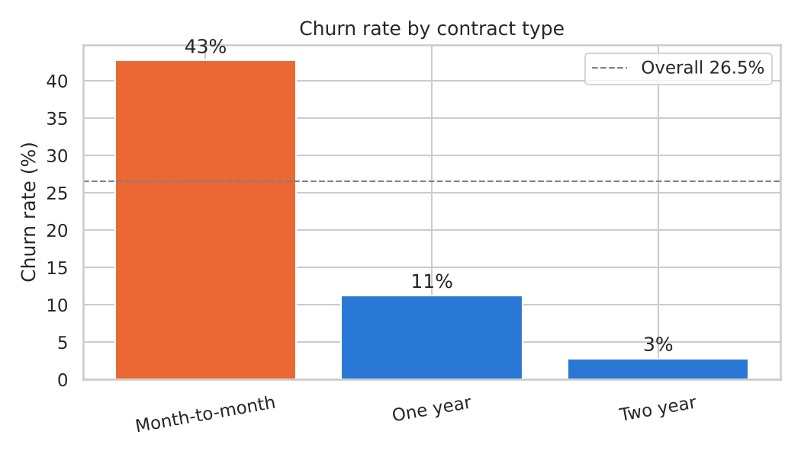
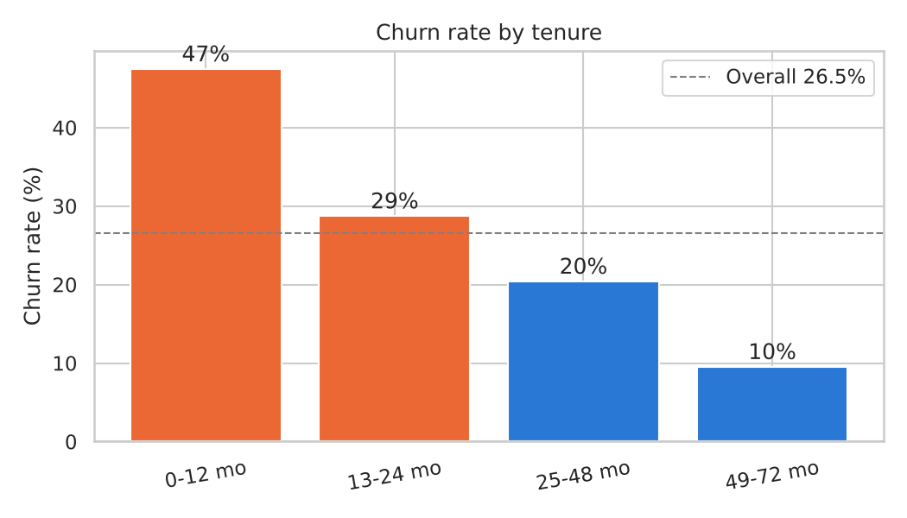
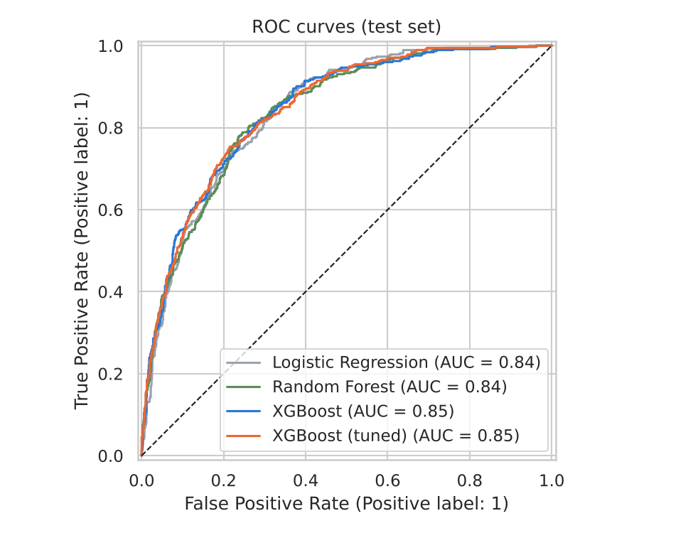
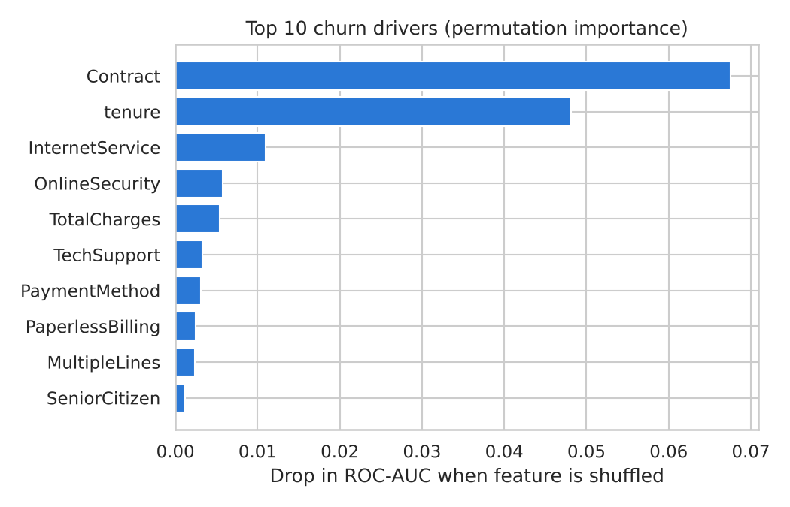

# Customer Churn Prediction (Machine Learning)

Predicting which telecom customers are likely to leave, using Python and scikit-learn, so a retention team knows who to contact first.

**Dataset:** [IBM Telco Customer Churn](https://github.com/IBM/telco-customer-churn-on-icp4d), with 7,043 customers and 21 columns covering demographics, services, contract, billing and a churn label.

## Results

| Model | ROC-AUC | Recall | Precision | F1 |
|---|---|---|---|---|
| Logistic Regression | 0.841 | 0.794 | 0.501 | 0.614 |
| Random Forest | 0.840 | 0.781 | 0.540 | 0.638 |
| XGBoost | 0.846 | 0.791 | 0.521 | 0.628 |
| **XGBoost (tuned, final)** | **0.846** | **0.807** | 0.508 | 0.624 |

*Scores are on the held-out test set (1,409 customers). 5-fold cross-validated ROC-AUC for the tuned model is 0.850.*

- The final model catches **81% of customers who actually churn** (recall).
- The **top 20% riskiest customers** it flags contain **51% of all churners**. Their churn rate is 68%, against 27% overall, a **2.5x lift**.

## Key findings

1. **26.5%** of customers churn, so the target is imbalanced. Models are judged on ROC-AUC, recall and F1 rather than accuracy, and are trained with class weights.
2. **Contract type** is the strongest driver. Month-to-month customers churn at **43%**, against **3%** for two-year contracts.
3. **47% of first-year customers churn.** Customers with 4+ years of tenure churn at only 10%.
4. **Fiber optic** (42%) and **electronic check** (45%) customers are high-risk groups.
5. Chi-square tests show that **gender and phone service have no significant link** to churn (p > 0.05). Contract, security and tech support add-ons, internet service and payment method are all significant (p < 0.001).

<p>




</p>

## Approach

**1. Data cleaning and EDA** (`notebooks/01_data_cleaning_eda.ipynb`)
- Converted `TotalCharges` from text to numbers. Its 11 blank values all belong to customers with tenure 0, so they were set to 0 instead of the mean.
- Visualised churn rate by contract, tenure, internet service and payment method.
- Ran **Chi-square** tests (with Cramér's V) on categorical features and **Mann-Whitney U** tests on numeric ones.

**2. Feature engineering and modeling** (`notebooks/02_modeling.ipynb`)
- Engineered features: `NumServices`, `AvgMonthlySpend`, `IsNewCustomer` (tenure ≤ 12 months) and `AutoPay`.
- Built a scikit-learn `Pipeline` with `ColumnTransformer` (StandardScaler + OneHotEncoder) to prevent data leakage.
- Used a stratified 80/20 train/test split and compared Logistic Regression, Random Forest and XGBoost with **5-fold stratified cross-validation**.
- Tuned XGBoost hyperparameters with **GridSearchCV**.
- Evaluated with ROC curves, a confusion matrix and a classification report, and explained the model with **permutation importance**.
- Saved the final pipeline to `models/churn_xgb_pipeline.joblib`.

## Project structure

```
customer-churn-prediction/
├── data/
│   ├── raw/Telco-Customer-Churn.csv
│   └── processed/churn_clean.csv
├── notebooks/
│   ├── 01_data_cleaning_eda.ipynb
│   └── 02_modeling.ipynb
├── images/            # 10 charts used in this README
├── models/            # saved scikit-learn pipeline
├── requirements.txt
└── README.md
```

## How to run

```bash
pip install -r requirements.txt
jupyter notebook notebooks/01_data_cleaning_eda.ipynb
```
Run notebook 01 first, because it creates `data/processed/churn_clean.csv`, then run 02.

## Tools

Python · Pandas · NumPy · Scikit-learn · XGBoost · SciPy · Matplotlib · Seaborn · Jupyter

**Author:** Aditya Kale · [GitHub](https://github.com/Adityak0012) · [LinkedIn](https://www.linkedin.com/in/AdityaK0012)
