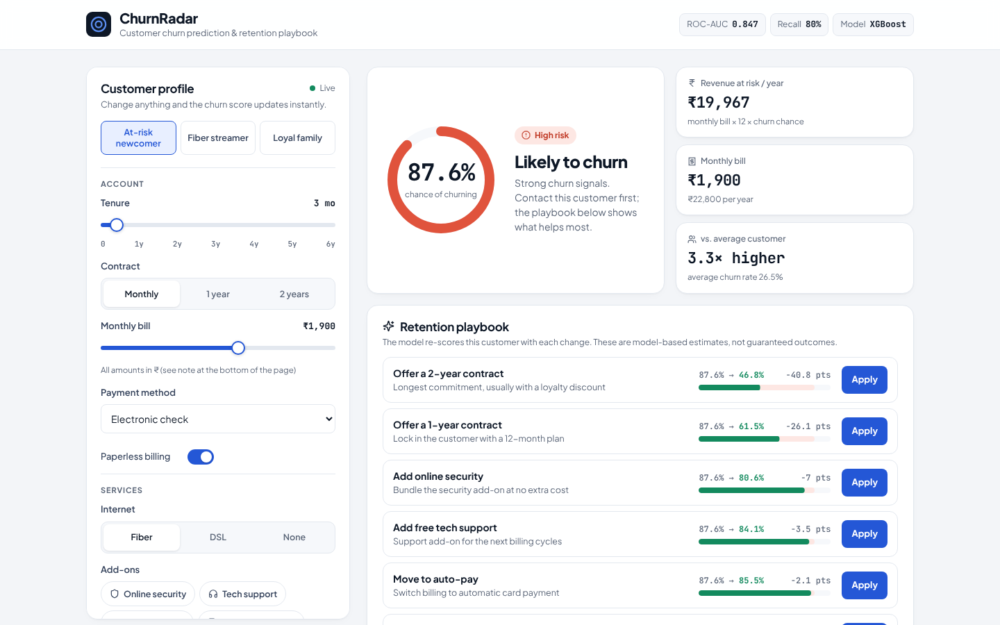
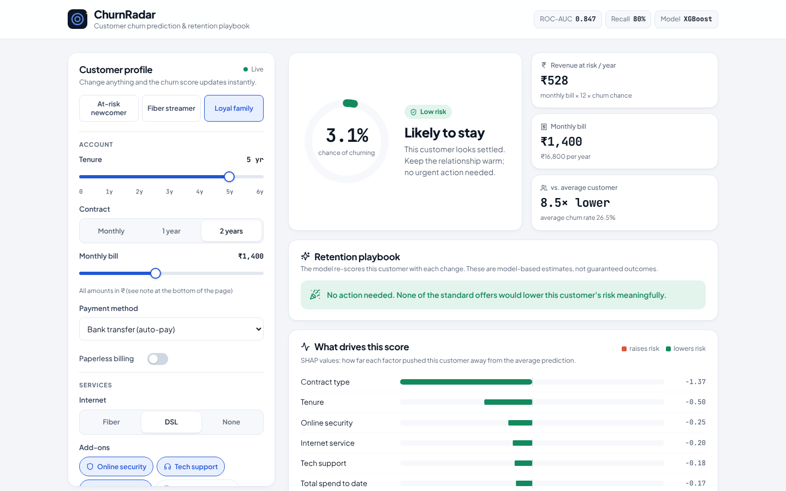
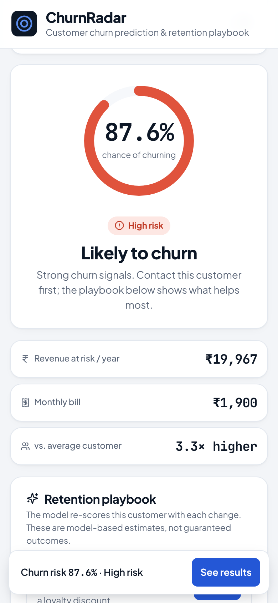
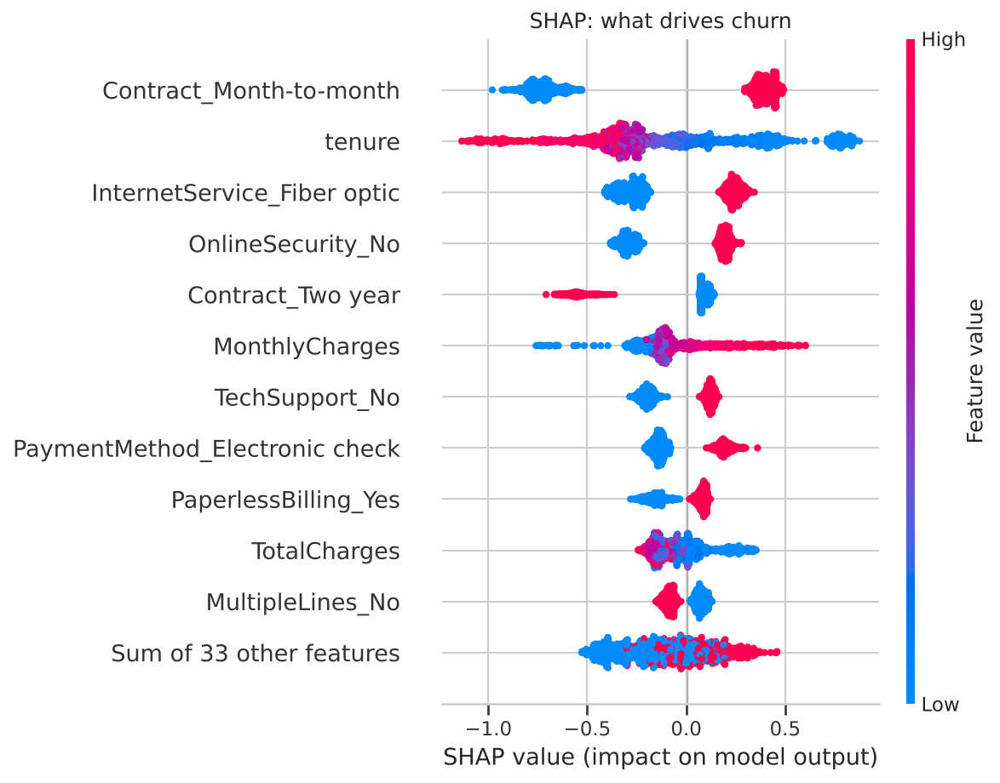
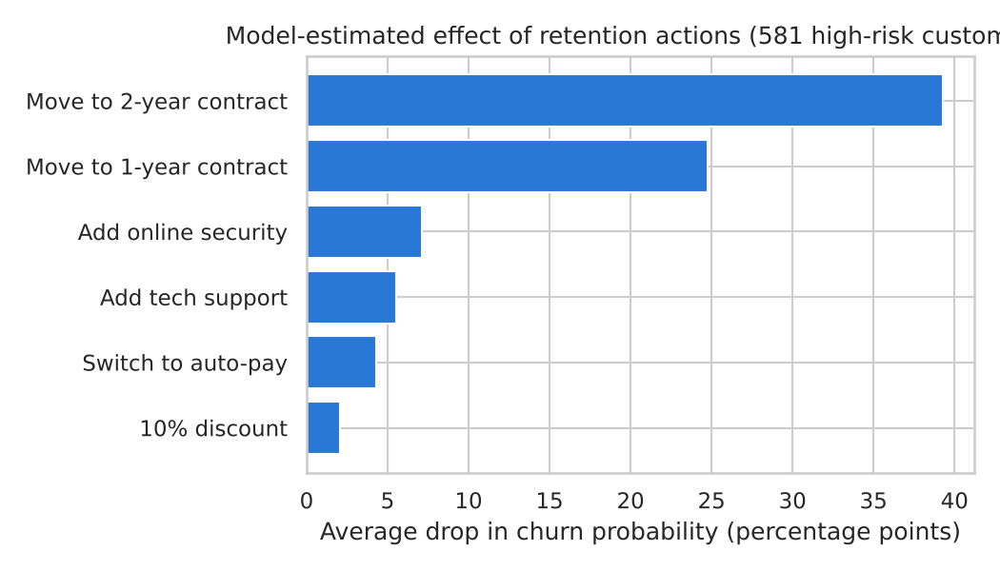

# ChurnRadar: Customer Churn Prediction & Retention Playbook

An end-to-end machine learning project that predicts which telecom customers are about to leave, explains **why** with SHAP, and recommends the **retention actions** that would lower each customer's risk the most. The model is served by a **Flask API** with an animated **React + Framer Motion** dashboard that re-scores the customer live as you edit their profile.



🎬 **Demo video:** [docs/churnradar_demo.mp4](docs/churnradar_demo.mp4)

## What the app does

- **Live scoring.** Change tenure, contract, monthly bill, services or payment method, and the churn probability updates instantly, with no submit button.
- **Risk ring and tier.** The app shows the churn chance with a low, medium or high risk tier.
- **Revenue at risk.** This is the expected annual revenue loss for the customer (monthly bill × 12 × churn chance), shown in ₹.
- **Retention playbook.** The model re-scores the customer with each possible offer: a 1-year or 2-year contract, free tech support, online security, auto-pay, or a 10% discount. The offers are ranked by how much they cut the risk. Click **Apply** to update the profile, or **Undo** to go back.
- **What drives this score.** SHAP values show the factors pushing this customer's risk up or down.
- **Sample customers.** One-click presets for an at-risk newcomer, a fiber streamer and a loyal family.

<p>


</p>

**Design and UX:**
- A clean dashboard with one accent colour, Plus Jakarta Sans for text and JetBrains Mono for numbers. Both fonts are bundled with the app, so it works offline.
- **Framer Motion animations:** the ring and the numbers count up, segmented controls have a sliding highlight, toggles have spring knobs, the playbook rows reorder with layout animations, and an undo toast appears after each action.
- **Accessibility:** keyboard-accessible radio groups and switches, visible focus rings, `aria-live` score updates, reduced-motion support and a sticky risk bar on mobile.

## Model results (held-out test set, 1,409 customers)

| Model | ROC-AUC | PR-AUC | Recall | Precision | F1 |
|---|---|---|---|---|---|
| Logistic Regression | 0.842 | 0.629 | 0.786 | 0.505 | 0.615 |
| Random Forest | 0.839 | 0.643 | 0.773 | 0.537 | 0.634 |
| XGBoost | 0.846 | 0.666 | 0.794 | 0.518 | 0.627 |
| LightGBM | 0.842 | 0.659 | 0.789 | 0.530 | 0.634 |
| **XGBoost (tuned, final)** | **0.847** | 0.665 | **0.802** | 0.516 | 0.628 |

*Metrics use a 0.5 cut-off. The tuned model's 5-fold cross-validated ROC-AUC is 0.850.*

- The model **catches 80% of customers who actually churn**.
- The **top 20% riskiest customers** contain **51% of all churners**, a 2.5x lift over random targeting.
- **Risk tiers:**

| Tier | Share of customers | Actual churn rate |
|---|---|---|
| Low (<25%) | 40% | 3.9% |
| Medium (25–50%) | 19% | 19.2% |
| High (50%+) | 41% | 51.6% |

## Key findings

1. **26.5%** of customers churn, so the target is imbalanced. Models use class weights and are judged on ROC-AUC, recall and F1.
2. **Contract type** is the strongest driver. Month-to-month customers churn at **43%**, against **3%** on two-year contracts.
3. **47% of first-year customers churn.** After four years, only 10% do.
4. **Fiber optic** (42%) and **electronic check** (45%) customers are high-risk groups.
5. **What-if analysis on high-risk customers** (model-estimated average drop in churn probability):

| Retention action | Average drop |
|---|---|
| 2-year contract | **−39 pts** |
| 1-year contract | −25 pts |
| Online security | −7 pts |
| Tech support | −5.5 pts |
| Auto-pay | −4 pts |
| 10% discount | −2 pts |

   A discount is the least effective lever. Contract length matters far more than price.

<p>




</p>

## Approach

**1. Data cleaning and EDA** (`notebooks/01_data_cleaning_eda.ipynb`)
- Converted `TotalCharges` from text to numbers. Its 11 blanks all belong to brand-new customers (tenure 0), so they were set to 0.
- Visualised churn by contract, tenure, internet service and payment method.
- Ran **Chi-square** tests (with Cramér's V) on categorical features and **Mann-Whitney U** tests on numeric ones. Gender and phone service were *not* significant.

**2. Modeling and explainability** (`notebooks/02_modeling.ipynb`)
- **Engineered features:** `NumServices`, `IsNewCustomer` (tenure ≤ 12 months), `AutoPay` and `HasProtection`.
- Built a leakage-free scikit-learn `Pipeline` (`ColumnTransformer` with StandardScaler and OneHotEncoder) on a stratified 80/20 split.
- Compared 4 models with **5-fold stratified cross-validation** and tuned XGBoost with **RandomizedSearchCV**.
- Chose the decision threshold from out-of-fold predictions, explained the model with **SHAP**, and ran **what-if simulations** of retention actions.
- Saved the model in portable formats: XGBoost native JSON plus the joblib preprocessor.

**3. Web app**
- **Backend** (`app/app.py`): a Flask REST API.
  - `/api/predict` validates the input, scores the customer, groups SHAP values back to readable factors, and simulates each retention action.
  - `/api/meta` returns the model metrics.
- **Frontend** (`frontend/`): React and Vite with **Framer Motion** (`motion`) and Lucide icons. It is built into `app/static/dist`, so Flask serves the whole app.

### Amounts in Indian rupees (₹)
The model was trained on US data in dollars. The app works in **₹** and converts at a **purchasing-power-parity rate of ₹21 = $1**, so a typical Indian monthly bill (₹300–₹3,000) maps to the bill range in the training data. To change the rate, edit `INR_PER_USD` in `app/app.py`.

## Run it locally

```bash
pip install -r requirements.txt
python app/app.py
```
Then open **http://127.0.0.1:5000**. The frontend is already built, so you don't need Node.js to run the app.

**To edit the frontend** (needs Node.js 18+):
```bash
cd frontend
npm install
npm run dev      # dev server at http://localhost:5173 (keep app.py running)
npm run build    # rebuilds into app/static/dist
```

To retrain the model, run `notebooks/01_data_cleaning_eda.ipynb` and then `02_modeling.ipynb`.

## Project structure

```
customer-churn-prediction/
├── app/
│   ├── app.py                 # Flask API: scoring, SHAP, retention what-ifs
│   └── static/dist/           # built React frontend
├── frontend/                  # React + Vite + Framer Motion source
│   └── src/ (App.jsx, components/, profile.js, styles.css)
├── data/
│   ├── raw/Telco-Customer-Churn.csv
│   └── processed/churn_clean.csv
├── models/
│   ├── xgb_model.json          # trained XGBoost (native, portable format)
│   ├── preprocessor.joblib     # fitted scikit-learn ColumnTransformer
│   └── model_meta.json         # threshold, tiers, metrics
├── notebooks/
│   ├── 01_data_cleaning_eda.ipynb
│   └── 02_modeling.ipynb
├── images/
├── docs/churnradar_demo.mp4
├── requirements.txt
└── README.md
```

## Tools

Python · Pandas · NumPy · Scikit-learn · XGBoost · LightGBM · SHAP · SciPy · Matplotlib · Seaborn · Flask · React · Framer Motion · Vite

**Dataset:** [IBM Telco Customer Churn](https://github.com/IBM/telco-customer-churn-on-icp4d) (7,043 customers). *Educational project.*

**Author:** Aditya Kale · [GitHub](https://github.com/Adityak0012) · [LinkedIn](https://www.linkedin.com/in/AdityaK0012)
